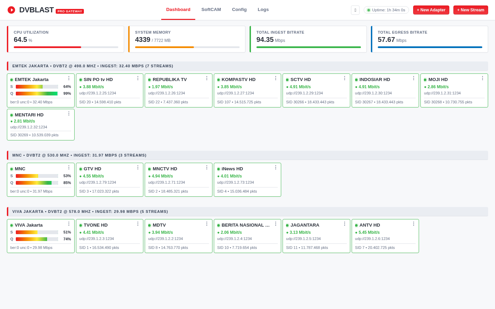

# DVBlast Web Gateway

[](COPYING)
[](https://www.kernel.org)
[](https://en.wikipedia.org/wiki/C99)
[](#requirements)

**DVBlast Web Gateway** is an enhanced, high-performance distribution of [VideoLAN's DVBlast](https://www.videolan.org/projects/dvblast.html) equipped with an **embedded Web Management Gateway**, **multi-adapter worker supervisor**, **live transponder channel scanner**, and **POSIX shared-memory telemetry**.

It transforms DVBlast into a modern broadcast-grade DVB-to-IP gateway while maintaining DVBlast's legendary sub-millisecond latency, zero-packet-drop reliability, and lightweight C footprint.

---

<p align="center">
  
</p>

---

## 🌟 Key Features

* **🌐 Embedded Web Management Gateway (`--web-port 8088`)**
  * Zero external runtime dependencies: HTML5, CSS3, and JavaScript are byte-embedded directly into the single C binary (`dvblast`).
  * No Node.js, Python, Nginx, or external web servers required.
* **📡 Multi-Adapter Worker Supervisor**
  * Overcomes DVBlast's historical singleton state limitation.
  * Concurrently tune and stream from multiple physical DVB tuners (`/dev/dvb/adapter0`, `adapter1`, `adapter2`...) with process isolation.
  * Adding, editing, scanning, or retuning secondary adapters never drops packets on active streams.
* **⚡ High-Performance POSIX Shared Memory (`/dev/shm/dvblast_stats.dat`)**
  * Zero-lock atomic cross-process telemetry.
  * Real-time aggregated system Ingest bitrate (up to 100+ Mbps) and Egress bitrate without CPU context-switching overhead.
* **🔍 Live Channel Scanner (PAT / SDT Demux)**
  * Non-intrusive background transponder scanner.
  * Demuxes Service IDs (PNR/SID), channel names, network providers, PMT PIDs, and encryption flags (FTA vs. Scrambled).
  * 1-Click batch multicast IP stream generator.
* **🔑 Integrated SoftCAM CSA / BISS-1 Descrambler**
  * Real-time hardware/software descrambler with BISS-1 and Constant CW key support.
  * Live monitoring of descrambled packet counters per channel.
* **⏱️ UDP Packet Pacing**
  * Microsecond-accurate 1316-byte batch UDP pacing to prevent network switch buffer overflows and PCR jitter.
* **🎨 Clean VideoLAN Theme & Transponder Stack Layout**
  * Clean UI following VideoLAN design language with light and dark mode toggles.
  * Transponder-grouped card stack grid with rainbow Signal Strength (**S**) and SNR Quality (**Q**) level meters.
  * Full REST API (`/api/v1/...`) for external automation and monitoring.

---

## 🚀 Quick Start Guide

### 1. Requirements & Build Dependencies

On Debian / Ubuntu:
```bash
sudo apt update
sudo apt install build-essential libev-dev libdvbpsi-dev libjansson-dev libasound2-dev
```

### 2. Compile

Clone this repository and compile with `make`:
```bash
git clone git@github.com:arcdefense/dvblast-web.git
cd dvblast-web
make -j$(nproc)
```
This produces a single standalone binary: `./dvblast`.

### 3. Run DVBlast with Web Gateway

Launch DVBlast with the `--web-port` and `--json-config` arguments:
```bash
./dvblast --web-port 8088 --json-config dvblast.json
```

Now open your web browser:
```
http://localhost:8088/
```
*(Or replace `localhost` with your server's IP address, e.g. `http://192.168.1.100:8088/`)*

---

## 📖 CLI Options & Arguments

DVBlast Web Gateway supports all original DVBlast flags plus new gateway flags:

| Flag | Description |
|---|---|
| `--web-port <port>` | Enables embedded HTTP Web Gateway & REST API on specified port (default: `8088`). |
| `--json-config <file>` | Path to persistent JSON configuration file (e.g. `dvblast.json`). Automatically saves and reloads tuners and streams. |
| `--disable-web` | Disables the web gateway and runs in pure standalone legacy CLI mode. |
| `-a, --adapter <idx>` | Primary DVB adapter index (e.g. `0` for `/dev/dvb/adapter0`). |
| `-f, --frequency <Hz/kHz>` | Tuning frequency (`Hz` for DVB-T/T2, `kHz` for DVB-S/S2). |
| `-b, --bandwidth <MHz>` | Bandwidth in MHz for DVB-T/T2 (e.g. `8`). |
| `-m, --modulation <type>` | Constellation/modulation (`qpsk`, `16qam`, `64qam`, `256qam`, `psk_8`). |
| `-u, --udp` | Use raw UDP output instead of default RTP. |
| `-c, --config-file <file>` | Legacy DVBlast output configuration file. |
| `-r, --remote-socket <path>` | UNIX domain socket for `dvblastctl` control. |

---

## 🌐 Web Dashboard Features

### 1. Transponder Grouping
* Each physical DVB adapter is displayed as an independent row with a clean header:
  ```
  EMTEK JAKARTA • DVB-T2 @ 498.0 MHZ • INGEST: 32.50 MBPS (7 STREAMS)
  ```
* Under the transponder header:
  * **Adapter Card**: Displays live Lock status, Signal Strength (**S**) bar, SNR Quality (**Q**) bar, BER, and Ingest bitrate.
  * **Stream Cards**: Displays TV channel name, live on-air bitrate, multicast destination (e.g. `udp://239.1.2.25:1234`), and packet metrics.

### 2. Actions Dropdown Menu (`⋮`)
* **Adapter Card**:
  * `Restart`: Retunes and resets hardware frontend.
  * `Disable / Enable`: Toggles tuner on/off without affecting other adapters.
  * `Scan Channels`: Opens live channel demux scanner.
  * `Edit`: Change tuning frequency, delivery system, bandwidth, PLP, or modulation.
  * `Remove`: Deletes adapter and related streams.
* **Stream Card**:
  * `Disable / Enable`: Temporarily pause/resume multicast transmission.
  * `Edit`: Modify multicast destination IP, port, TTL, pacing, or BISS key.
  * `Remove`: Deletes stream output.

### 3. Channel Scanner & Batch Stream Creator
1. Click `⋮` on any locked adapter -> select **Scan Channels**.
2. The scanner demuxes PAT/SDT tables and lists all available TV services.
3. Check the desired channels, set your **Base Multicast IP** (e.g. `239.1.2.25`) and **Port** (`1234`).
4. Click **Create Selected** — individual SPTS streams are generated automatically with incrementing multicast IP addresses!

---

## 📡 REST API Reference

DVBlast Web Gateway provides a comprehensive JSON REST API:

### System & Telemetry
* `GET /api/v1/system` - Returns server uptime, CPU usage, RAM utilization, aggregated input/output bitrates, and packet counters.
* `GET /api/v1/logs` - Retrieves recent system event logs.

### Adapters & Tuning
* `GET /api/v1/adapters` - Returns all configured DVB adapters, lock status, signal/SNR values, and discovered channels.
* `POST /api/v1/adapters` - Adds or updates an adapter configuration.
* `POST /api/v1/adapters/toggle` - Enables or disables an adapter (`{"id": "adapter_0", "enabled": true}`).
* `POST /api/v1/adapters/restart` - Triggers adapter hardware retuning (`{"id": "adapter_0"}`).
* `POST /api/v1/adapters/scan` - Triggers background channel demux scanning (`{"id": "adapter_0"}`).
* `POST /api/v1/adapters/delete` - Deletes an adapter configuration (`{"id": "adapter_0"}`).
* `GET /api/v1/hardware` - Detects available physical DVB adapters and frontends in the Linux host.

### Streams & Routing
* `GET /api/v1/streams` - Lists all configured multicast output streams with live bitrates and packet counters.
* `POST /api/v1/streams` - Creates or edits a multicast stream.
* `POST /api/v1/streams/toggle` - Starts or stops a stream (`{"id": "stream_1", "enabled": false}`).
* `POST /api/v1/streams/delete` - Removes a stream (`{"id": "stream_1"}`).

### SoftCAM Keys
* `GET /api/v1/softcam` - Lists registered BISS / Constant CW keys.
* `POST /api/v1/softcam` - Registers or updates a descrambler key.
* `POST /api/v1/softcam/delete` - Deletes a key.

---

## 🏗️ Architecture

```
                       ┌─────────────────────────────────────────┐
                       │     Master Process (dvblast: 8088)      │
                       │   - Embedded HTTP Server & REST API     │
                       │   - Primary Tuner (/dev/dvb/adapter0)   │
                       │   - Worker Process Supervisor           │
                       └───────────────────┬─────────────────────┘
                                           │
          ┌────────────────────────────────┼────────────────────────────────┐
          │                                │                                │
┌─────────▼──────────────┐       ┌─────────▼──────────────┐       ┌─────────▼──────────────┐
│  Worker (dvblast-ad1)  │       │  Worker (dvblast-ad2)  │       │  Worker (dvblast-adN)  │
│  Tuner: adapter1       │       │  Tuner: adapter2       │       │  Tuner: adapterN       │
│  Isolated Child Proc   │       │  Isolated Child Proc   │       │  Isolated Child Proc   │
└─────────┬──────────────┘       └─────────┬──────────────┘       └─────────┬──────────────┘
          │                                │                                │
          └────────────────────────────────┼────────────────────────────────┘
                                           │
                               ┌───────────▼───────────┐
                               │   POSIX Shared Memory │
                               │ /dev/shm/dvblast_stats│
                               │ - Atomic Input Bytes  │
                               │ - Atomic Output Pkts  │
                               └───────────────────────┘
```

---

## 📜 License & Acknowledgements

* **License**: GNU General Public License version 2 ([GPL-2.0](COPYING)).
* **Original Project**: Developed by the [VideoLAN team](https://www.videolan.org/projects/dvblast.html) (Christophe Massiot, Jean-Paul Saman, Marian Durkovic, and contributors).
* **Original Documentation**: See the original [README](README) file for upstream legacy DVBlast plain-text documentation.
* **Enhanced Web Distribution**: Maintained by [arcdefense](https://github.com/arcdefense/dvblast-web).
